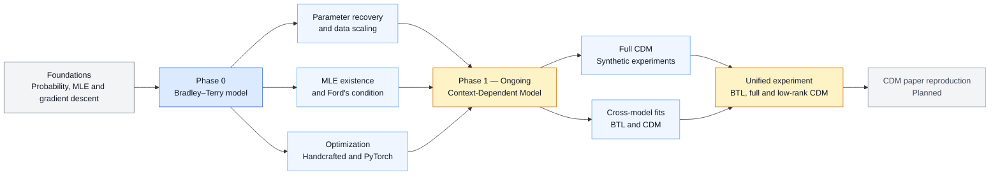
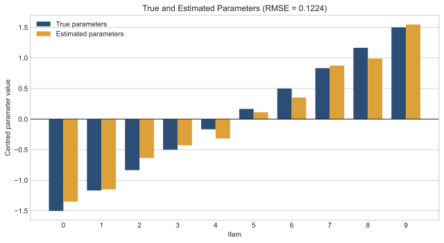
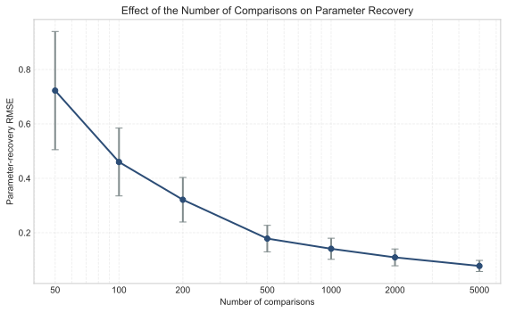
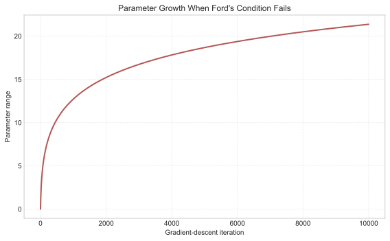
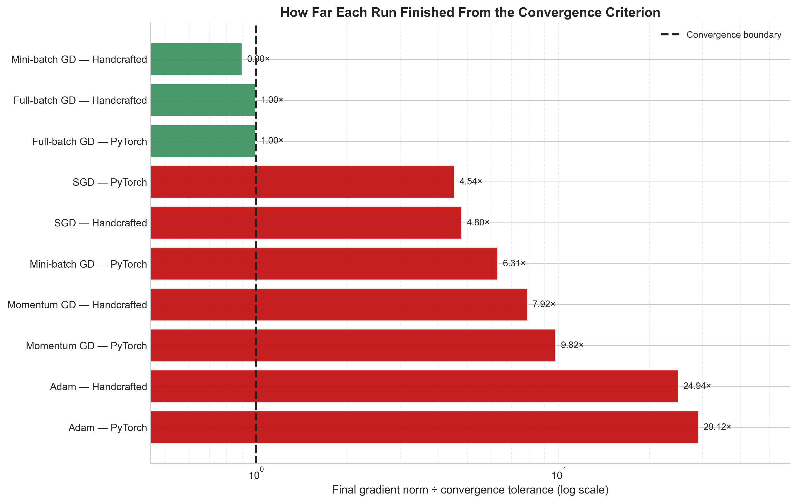
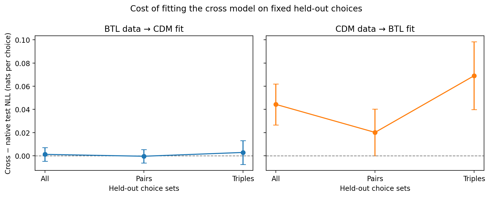
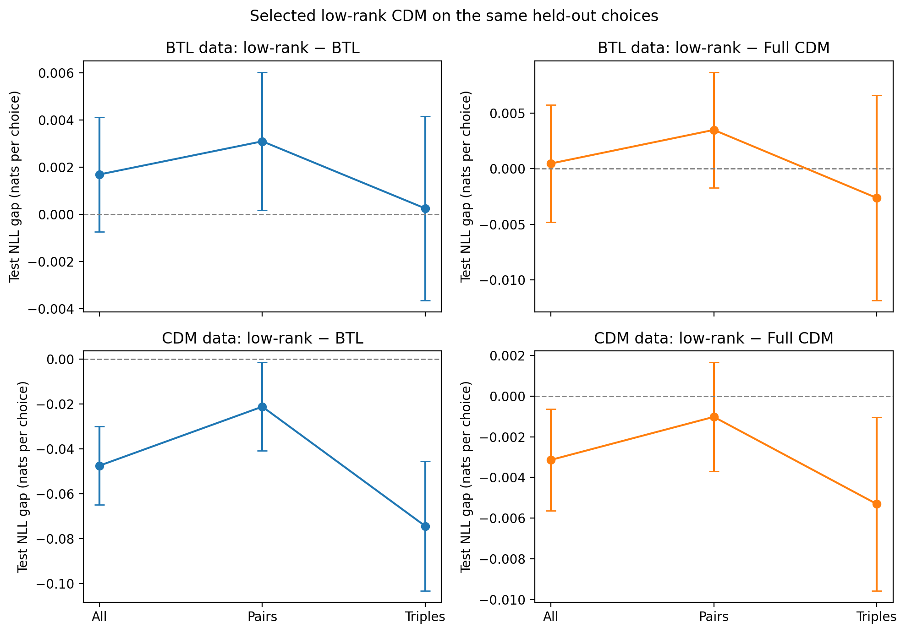

# Learning from Comparison Data

Research code and [thesis notes](https://github.com/rbhdsks/Learning-from-Comparison-Data-Master-Thesis-Project-/blob/main/docs/thesis/Notes.pdf) for my M.Tech project on learning preference models from observed choice data.

The project begins with the Bradley–Terry model for pairwise comparisons and extends towards context-dependent choice models.

## Research workflow



## Research progress

| Phase | Focus | Status |
| --- | --- | --- |
| Phase 0 | Bradley–Terry model and maximum-likelihood estimation | Core experiments completed |
| Phase 1 | Full and low-rank CDM, synthetic comparisons, and paper reproduction | Synthetic experiments in progress; reproduction planned |

### Phase 0: Bradley–Terry Model and MLE

The completed experiments study:

- parameter recovery from simulated comparisons;
- recovery error as the number of comparisons and items changes;
- existence and uniqueness of the finite MLE, including Ford's condition;
- failure of the finite MLE under perfect separation;
- convergence and runtime of handcrafted and PyTorch optimizers.

### Representative Bradley–Terry results

<table>
  <tr>
    <td align="center" width="50%">
      
      <br>
      <sub>True and estimated Bradley–Terry parameters.</sub>
    </td>
    <td align="center" width="50%">
      
      <br>
      <sub>Parameter-recovery error with increasing comparisons.</sub>
    </td>
  </tr>
  <tr>
    <td align="center" width="50%">
      
      <br>
      <sub>Parameter divergence when Ford's condition fails.</sub>
    </td>
    <td align="center" width="50%">
      
      <br>
      <sub>Final gradient norms relative to the convergence tolerance.</sub>
    </td>
  </tr>
</table>

### Phase 1: Context-Dependent Models

This phase covers full-CDM estimation, BTL–CDM cross-model experiments, low-rank CDM, and reproduction of experiments from the CDM paper.

**Unified synthetic experiment:** BTL, full CDM, and low-rank CDM are fitted to common synthetic choice sets and compared using held-out NLL, optimization diagnostics, and runtime.

#### Current synthetic results



*Held-out NLL cost of cross-model fitting on BTL- and CDM-generated choices.*



*Paired test NLL gaps for the validation-selected low-rank CDM fits.*

These figures show one synthetic run. The selected rank-5 fit reached the epoch limit without meeting the gradient convergence criterion, so broader conclusions require further runs and optimization checks.

Paper reproduction, including experiments beyond six items, is planned as further work within Phase 1.

## Repository structure

| Path | Purpose |
| --- | --- |
| `notebooks/archive/` | Earlier notebooks preserved for reference |
| `notebooks/foundations/` | Mathematical derivations and small examples |
| `notebooks/practice/choix/` | Practice with the Choix library |
| `notebooks/experiments/` | Main thesis experiments |
| `src/bradley_terry/` | Reusable Bradley–Terry code |
| `src/context_dependent_model/` | Reusable full and low-rank CDM code |
| `docs/thesis/images/` | Thesis figures, including unified CDM results |
| `docs/thesis/tables/` | Tables generated for thesis experiments |
| `references/` | Reference implementations and supporting material |

Code under `references/` belongs to its original authors and is kept separate from the implementation developed in this project.

## Setup

The project requires Python 3.10 or later.

```bash
python3 -m venv .venv
source .venv/bin/activate
python -m pip install --upgrade pip
python -m pip install -e ".[notebooks,models]"
```

When opening a notebook, select `.venv` as the Python kernel.

## References

- Arjun Seshadri, Alex Peysakhovich, and Johan Ugander. [Discovering Context Effects from Raw Choice Data](https://proceedings.mlr.press/v97/seshadri19a.html). ICML, 2019.
- [Choix](https://github.com/lucasmaystre/choix): inference tools for models based on Luce's choice axiom.

## Project information

| | |
| --- | --- |
| Student | Nitesh Kumar Shah |
| Roll number | ID25M806 |
| Programme | M.Tech in Data Science and Artificial Intelligence |
| Supervisor | Prof. Suryanarayana Sankagiri |
| Institute | Indian Institute of Technology Madras |

This repository is under active development. Implementations, experiments, and documentation may change as the research progresses.