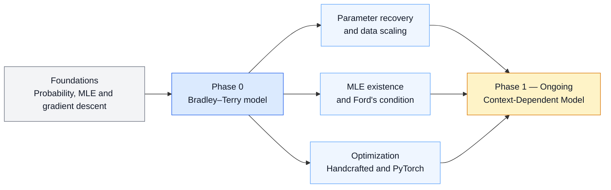

# Learning from Comparison Data

Research code and [thesis notes](https://www.overleaf.com/project/6a192de01f9877e35710e1d1)
for my M.Tech project on learning preference models from observed choice data.

The project begins with the Bradley–Terry model for pairwise comparisons
and extends towards context-dependent choice models.

## Research workflow



## Research progress

| Phase | Focus | Status |
| --- | --- | --- |
| Phase 0 | Bradley–Terry model and maximum-likelihood estimation | Core experiments completed |
| Phase 1 | Context-Dependent Model | In progress |

### Phase 0: Bradley–Terry Model and MLE

The completed work includes:

- parameter recovery from simulated comparisons;
- recovery error with increasing amounts of data;
- existence and uniqueness of the finite MLE;
- failure of the finite MLE under perfect separation;
- comparison of handcrafted and PyTorch optimizers.

### Representative results

<table>
  <tr>
    <td align="center" width="50%">
      
      <br>
      <sub>True and estimated Bradley–Terry parameters.</sub>
    </td>
    <td align="center" width="50%">
      
      <br>
      <sub>Parameter-recovery error with increasing comparisons.</sub>
    </td>
  </tr>
  <tr>
    <td align="center" width="50%">
      
      <br>
      <sub>Parameter divergence when Ford's condition fails.</sub>
    </td>
    <td align="center" width="50%">
      
      <br>
      <sub>Final gradient norms relative to the convergence tolerance.</sub>
    </td>
  </tr>
</table>

### Phase 1: Context-Dependent Model

The current phase focuses on implementing the Context-Dependent Model
in PyTorch, validating its likelihood calculations, and studying
parameter recovery using synthetic choice data.

## Repository structure

| Path | Purpose |
| --- | --- |
| `notebooks/archive/` | Earlier notebooks preserved for reference |
| `notebooks/foundations/` | Mathematical derivations and small examples |
| `notebooks/practice/choix/` | Practice with the Choix library |
| `notebooks/experiments/` | Main thesis experiments |
| `src/bradley_terry/` | Reusable Bradley–Terry implementations |
| `src/context_dependent_model/` | Context-Dependent Model implementation |
| `docs/thesis/` | Thesis source, figures, and references |
| `results/` | Generated experimental results |
| `references/` | Reference implementations and supporting material |

Code under `references/` belongs to its original authors and is kept
separate from the implementation developed in this project.

## Setup

The project requires Python 3.10 or later.

```bash
python3 -m venv .venv
source .venv/bin/activate
python -m pip install --upgrade pip
python -m pip install -e ".[notebooks,models]"
```

When opening a notebook, select `.venv` as the Python kernel.

## References

- Arjun Seshadri, Alex Peysakhovich, and Johan Ugander.
  [Discovering Context Effects from Raw Choice Data](https://proceedings.mlr.press/v97/seshadri19a.html).
  ICML, 2019.
- [Choix](https://github.com/lucasmaystre/choix):
  inference tools for models based on Luce's choice axiom.

## Project information

| | |
| --- | --- |
| Student | Nitesh Kumar Shah |
| Roll number | ID25M806 |
| Programme | M.Tech in Data Science and Artificial Intelligence |
| Supervisor | Prof. Suryanarayana Sankagiri |
| Institute | Indian Institute of Technology Madras |

This repository is under active development. Implementations,
experiments, and documentation may change as the research progresses.