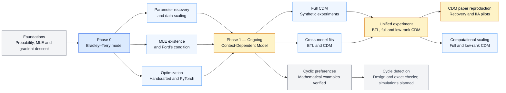

# Learning from Comparison Data

Research code and [thesis notes](https://github.com/rbhdsks/Learning-from-Comparison-Data-Master-Thesis-Project-/blob/main/docs/thesis/Notes.pdf) for my M.Tech project on learning preference models from observed choice data.

The project begins with the Bradley–Terry model for pairwise comparisons and extends to full and low-rank context-dependent choice models, synthetic paper reproduction, and the study of cyclic preferences.

## Research workflow



## Research progress

| Phase | Focus | Status |
| --- | --- | --- |
| Phase 0 | Bradley–Terry model and maximum-likelihood estimation | Core experiments completed |
| Phase 1 | Full and low-rank CDM, synthetic comparisons, computational scaling, and paper reproduction | Synthetic results and paper-reproduction pilots available; broader validation ongoing |
| Phase 1: Cyclic preferences | BTL–CDM relationships, cycle construction, and cycle-detection design | Mathematical examples verified; noisy-data detection experiments planned |

### Phase 0: Bradley–Terry Model and MLE

The completed experiments study:

- parameter recovery from simulated comparisons;
- recovery error as the number of comparisons and items changes;
- existence and uniqueness of the finite MLE, including Ford's condition;
- failure of the finite MLE under perfect separation;
- convergence and runtime of handcrafted and PyTorch optimizers.

### Phase 1: Context-Dependent Models

This phase covers full-CDM estimation, BTL–CDM cross-model experiments, low-rank CDM, computational scaling, and reproduction of experiments from the CDM paper.

**Unified synthetic experiment:** BTL, full CDM, and low-rank CDM are fitted to common synthetic choice sets and compared using held-out NLL, optimization diagnostics, and runtime.

The unified results currently cover one synthetic run. The selected rank-5 fit reached the epoch limit without meeting the gradient convergence criterion, so broader conclusions require further runs and optimization checks. See the [unified notebook](notebooks/experiments/Context_Dependent_Model/Low%20Rank%20CDM/04-Unifiednotebook.ipynb) for the paired held-out NLL comparisons and fit diagnostics.

#### Full versus low-rank computational scaling

The resource-scaling notebook measures runtime, time per training step, trainable parameter count, and sampled process memory as the number of items increases. Models share observations within each repeat and use the same training-step budget.

These results benchmark the existing dense-matrix implementations. Sampled process memory includes Python and PyTorch overhead; the experiment measures computational cost under a fixed step budget, rather than time to convergence or parameter recovery.

#### CDM paper reproduction

The paper-reproduction notebooks now contain synthetic full-CDM parameter recovery and likelihood-ratio tests of Independence of Irrelevant Alternatives (IIA):

- **Synthetic recovery:** study recovery error as the number of observed choices increases, with repeated runs and diagnostics for rare choices and separation.
- **Synthetic IIA tests:** generate choices from MNL, full CDM, and a general choice system; compare MNL against full CDM and the universal choice model using repeated-dataset pilots.
- **Separation diagnostics:** distinguish numerical optimizer stopping from the existence of a finite unregularized CDM maximum-likelihood estimate.

The IIA results are pilot experiments. Incomplete fits, separation, and boundary outcomes require care when interpreting nominal chi-square likelihood-ratio tests. Larger repeated experiments and recovery extensions beyond the six-item paper setup remain further work.

#### Cyclic preferences and cycle detection

The foundation notebook [07 — BTL and CDM interactions and cycles](notebooks/foundations/Bradley_Terry_Model_MLE/07_BTL_vs_CDM_Interactions_and_Cycles.ipynb) verifies the CDM utility equations, constructs a three-item majority-preference cycle, demonstrates pairwise non-identifiability, and recovers BTL as a special case of CDM.

It establishes model relationships using specified parameters; it does not estimate cycles from noisy observations.

The [cycle-detection design notebook](notebooks/experiments/Context_Dependent_Model/Cyclic_Preferences/01_Cycle_Detection_Design.ipynb) contains executed exact-probability checks and a plan for graph detection, sampled comparisons, simultaneous confidence intervals, and repeated experiments. The general detector and noisy-data experiments are not yet implemented.

## Representative results

Six figures summarize the current synthetic experiments: BTL recovery and MLE existence, full-CDM recovery, computational scaling, context-dependent misspecification, and the IIA-testing pilot. Each figure links to its source notebook.

<table>
  <tr>
    <td align="center" width="50%" valign="top">
      <!-- 00_BTL_recovery_noofitems.ipynb: cell 15, saved PNG output. -->
      
      <br>
      <sub><strong>BTL parameter recovery.</strong> Recovery improves as comparisons increase. Error bars show ±1 SD across converged fits, from up to five runs per setting; settings without a finite MLE are excluded from the recovery averages.
      <a href="notebooks/experiments/Bradley_Terry_Model/00_BTL_recovery_noofitems.ipynb">Source notebook</a>.</sub>
    </td>
    <td align="center" width="50%" valign="top">
      <!-- 03_BradleyTerry_MLE_existence_uniqueness.ipynb: cell 24, saved PNG output. -->
      
      <br>
      <sub><strong>When the finite MLE fails.</strong> With perfectly separated outcomes, the parameter range keeps growing: connected comparisons alone do not guarantee a finite MLE when Ford's condition fails.
      <a href="notebooks/experiments/Bradley_Terry_Model/03_BradleyTerry_MLE_existence_uniqueness.ipynb">Source notebook</a>.</sub>
    </td>
  </tr>
  <tr>
    <td align="center" width="50%" valign="top">
      <!-- CDM_Paper_Reproduction/01_synthetic_recovery.ipynb: cell 37, saved PNG output. -->
      
      <br>
      <sub><strong>Full-CDM recovery up to 100,000 choices.</strong> Mean summed squared parameter error falls from 8.90 to 0.078 across ten runs with a fixed six-item true matrix. The dashed 1/m reference is descriptive and anchored at the largest sample size.
      <a href="notebooks/experiments/Context_Dependent_Model/CDM_Paper_Reproduction/01_synthetic_recovery.ipynb">Source notebook</a>.</sub>
    </td>
    <td align="center" width="50%" valign="top">
      <!-- Low Rank CDM/01-FullvsLowrankResourceScaling.ipynb: cell 8, third saved PNG output. -->
      
      <br>
      <sub><strong>Full versus low-rank computational cost.</strong> Training time for 250–5,000 items using 1,000 observations and 1,000 Adam updates. Means ±1 SD across five repeats benchmark the current dense implementations; this is not time to convergence.
      <a href="notebooks/experiments/Context_Dependent_Model/Low%20Rank%20CDM/01-FullvsLowrankResourceScaling.ipynb">Source notebook</a>.</sub>
    </td>
  </tr>
  <tr>
    <td align="center" colspan="2">
      <!-- Full CDM/02_CDM-BTL.ipynb: cell 47, saved PNG output. -->
      
      <br>
      <sub><strong>The cost of ignoring context.</strong> For five and ten items, the held-out NLL gap between fitted BTL/Luce and the true generating CDM grows with interaction strength. Points average ten runs per setting; gap error bars show ±1 SD. The CDM curve is an oracle reference, not a fitted CDM.
      <a href="notebooks/experiments/Context_Dependent_Model/Full%20CDM/02_CDM-BTL.ipynb">Source notebook</a>.</sub>
    </td>
  </tr>
  <tr>
    <td align="center" colspan="2">
      <!-- CDM_Paper_Reproduction/02_synthetic_iia_tests.ipynb: cell 27, saved PNG output. -->
      
      <br>
      <sub><strong>IIA-testing pilot.</strong> Two likelihood-ratio tests on 2,000 observations per dataset, with ten runs per generator and 95% exact binomial intervals. MNL false-positive counts are 1/10 and 2/10; both alternatives reject MNL in 10/10 runs under the other two generators. This small pilot does not establish nominal 5% calibration.
      <a href="notebooks/experiments/Context_Dependent_Model/CDM_Paper_Reproduction/02_synthetic_iia_tests.ipynb">Source notebook</a>.</sub>
    </td>
  </tr>
</table>

These results describe the recorded synthetic settings. Numerical optimizer convergence does not certify a finite unregularized MLE; the paper-reproduction notebooks retain additional separation and stopping diagnostics.

## Repository structure

| Path | Purpose |
| --- | --- |
| `notebooks/archive/` | Earlier notebooks preserved for reference |
| `notebooks/foundations/` | Mathematical derivations and small examples |
| `notebooks/archive/choix/` | Archived practice with the Choix library |
| `notebooks/experiments/` | Main thesis experiments |
| `src/bradley_terry/` | Reusable Bradley–Terry code |
| `src/context_dependent_model/` | Reusable full and low-rank CDM code |
| `src/cdm_paper_reproduction/` | Synthetic recovery, IIA tests, and separation diagnostics |
| `results/experiments/` | Saved numerical results, settings, and fit diagnostics |
| `docs/thesis/images/` | Thesis figures, including unified CDM results |
| `docs/thesis/tables/` | Tables generated for thesis experiments |
| `references/` | Reference implementations and supporting material |

See the [notebook guide](notebooks/README.md), [source-code guide](src/README.md), and [documentation guide](docs/README.md) for the detailed layout.

Code under `references/` belongs to its original authors and is kept separate from the implementation developed in this project.

## Setup

The project requires Python 3.10 or later.

```bash
python3 -m venv .venv
source .venv/bin/activate
python -m pip install --upgrade pip
python -m pip install -e ".[notebooks,models]"
```

When opening a notebook, select `.venv` as the Python kernel.

## References

- Arjun Seshadri, Alex Peysakhovich, and Johan Ugander. [Discovering Context Effects from Raw Choice Data](https://proceedings.mlr.press/v97/seshadri19a.html). ICML, 2019.
- [Choix](https://github.com/lucasmaystre/choix): inference tools for models based on Luce's choice axiom.

## Project information

| | |
| --- | --- |
| Student | Nitesh Kumar Shah |
| Roll number | ID25M806 |
| Programme | M.Tech in Data Science and Artificial Intelligence |
| Supervisor | Prof. Suryanarayana Sankagiri |
| Institute | Indian Institute of Technology Madras |

This repository is under active development. Implementations, experiments, and documentation may change as the research progresses.
